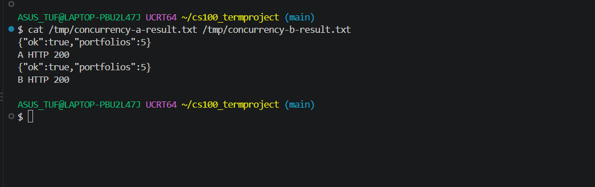

# Concurrency Test
- A later GET retry failed because the server became unreachable.
## Steps
1. Sent POST requests for `concurrency-a.json` and `concurrency-b.json` at the same time.
2. Checked the API response for each request.
3. Sent a GET request and searched the response for both test IDs.

## Results
- `test-concurrency-a`: HTTP 200
- `test-concurrency-b`: HTTP 200
- GET confirmed both IDs exist in the response.

## Screenshot
